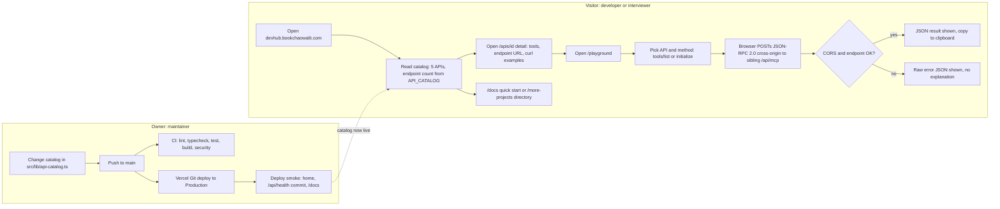
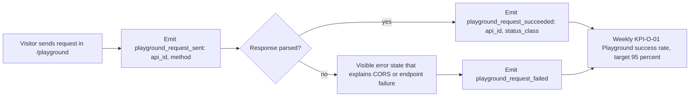

# 01 — Business process (As-Is / To-Be)

Status: **done**

DevHub เป็น "showcase product / developer portal" (ไม่ใช่ SaaS — `CLASSIFICATION.md` BD-017) ไม่มีบัญชีผู้ใช้ ไม่มีการชำระเงิน
กระบวนการธุรกิจจริงจึงมีแค่ (ก) นักพัฒนา/ผู้สัมภาษณ์ค้นหาและลอง MCP API ของ portfolio และ (ข) owner ดูแล catalog ให้ตรงกับ repo พี่น้อง

## As-Is (จากโค้ดวันนี้)

Sources: `src/app/page.tsx`, `src/app/apis/[id]/page.tsx`, `src/app/playground/page.tsx`, `src/app/docs/page.tsx`, `src/app/more-projects/page.tsx`,
`src/lib/api-catalog.ts`, `.github/workflows/ci.yml`, `.github/workflows/deploy-smoke.yml`, `scripts/deploy-smoke.sh`, `CLASSIFICATION.md`, `PRODUCT.md`

หมายเหตุ As-Is ที่พบตอนอ่านโค้ด/ตรวจจริง (2026-11-03):
- Playground ไม่มี error state ที่อธิบายสาเหตุ (`catch` แสดง `error.message` ดิบ) — ตรงกับ PRODUCT.md "What I'd improve next" ข้อ 2
- การ probe จริง (OPTIONS + POST จาก Origin `https://devhub.bookchaowalit.com`) ได้ผล: techblog 200, mcplist 200 (CORS allowlist ระบุ devhub), portfolio URL ใน catalog ตอบ **404**, artblog ตอบ **308** ไป `/api/mcp/`, techspace POST ตอบ **406** (ต้อง `Accept: application/json, text/event-stream`) — รายละเอียดใน [12-api-integration.md](12-api-integration.md)

## To-Be

แหล่ง To-Be ที่มีจริง: `PRODUCT.md` ("What I'd improve next") และ `docs/measurement/KPI-PLAN.md` (planned events) — ไม่มี `docs/UPGRADE-PLAN.md` และไม่มี issue เปิดอยู่

Sources: `PRODUCT.md` (What I'd improve next 1–4), `docs/measurement/KPI-PLAN.md` (KPI-O-01, event spec)

## Open questions

- เป้าหมาย To-Be ทางธุรกิจนอกเหนือจาก KPI-PLAN (เช่น ต้องการให้ DevHub เป็น front door ของ API gateway `gateway.bookchaowalit.com` หรือไม่) — ไม่มีเอกสารใน repo
- เครื่องมือ custom events (Vercel paid plan หรือ PostHog) — KPI-PLAN ระบุเป็น owner decision
