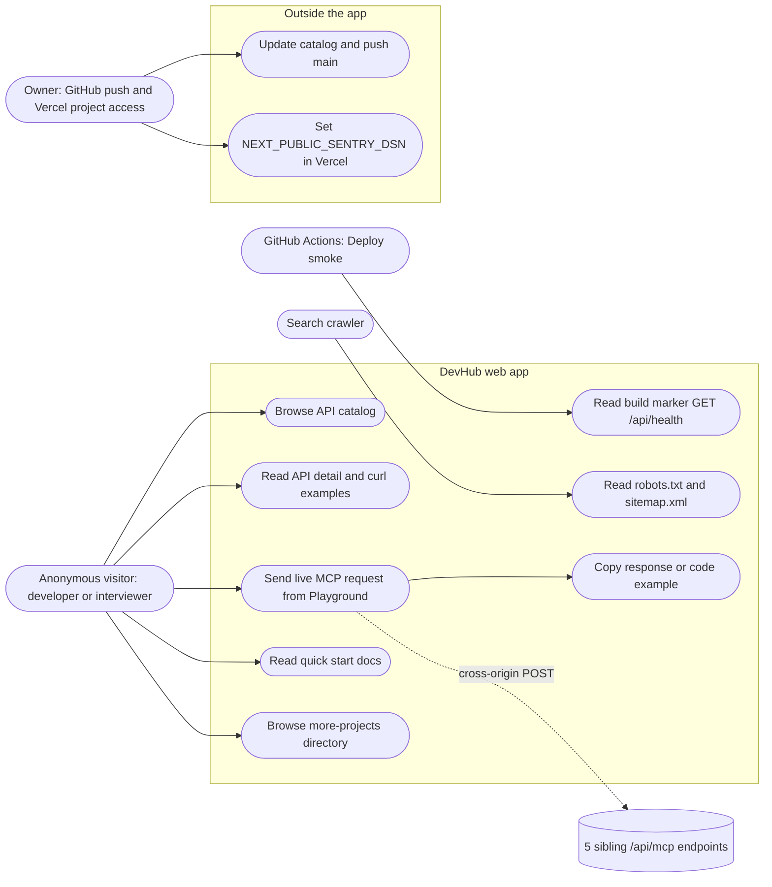

# 02 — Use cases

Status: **done**

ไม่มี auth ใน repo (ไม่มี middleware, session, cookie หรือ role) — ทุกหน้าเป็น public ดังนั้น actor ที่มีจริงคือ
visitor แบบไม่ระบุตัวตน, owner (สิทธิ์ผ่าน GitHub/Vercel ไม่ใช่ในแอป), GitHub Actions smoke checker และ search crawler

Sources: `src/app/page.tsx`, `src/app/apis/[id]/page.tsx`, `src/app/playground/page.tsx` (`makeRequest`, `copyToClipboard`), `src/app/docs/page.tsx`,
`src/app/more-projects/page.tsx`, `src/app/api/health/route.ts`, `public/robots.txt`, `public/sitemap.xml`, `scripts/deploy-smoke.sh`,
`.github/workflows/deploy-smoke.yml`, `specs/001-strict-build-ci-sentry/spec.md` §4 (DSN env)

| Use case | Actor | Route / file | Notes |
|---|---|---|---|
| Browse catalog | visitor | `/` | count = `API_CATALOG.length`, endpoints = sum of `tools.length` |
| API detail | visitor | `/apis/[id]` | SSG, `dynamicParams = false` → id อื่น 404 |
| Live request | visitor | `/playground` | `fetch(selectedApi.url, POST)`, method `tools/list` หรือ `initialize` เท่านั้น |
| Copy | visitor | `/playground` | `navigator.clipboard.writeText` |
| Docs | visitor | `/docs` | static content |
| More projects | visitor | `/more-projects` | 44 external links, 6 categories |
| Health | Deploy smoke | `/api/health` | `{status, service, commit}` |

## Open questions

- ไม่มี admin UI — การแก้ catalog ทำผ่านโค้ดเท่านั้น ยืนยันว่าเป็นความตั้งใจ (DESIGN.md "Keep API catalog values sourced from src/lib/api-catalog.ts")
