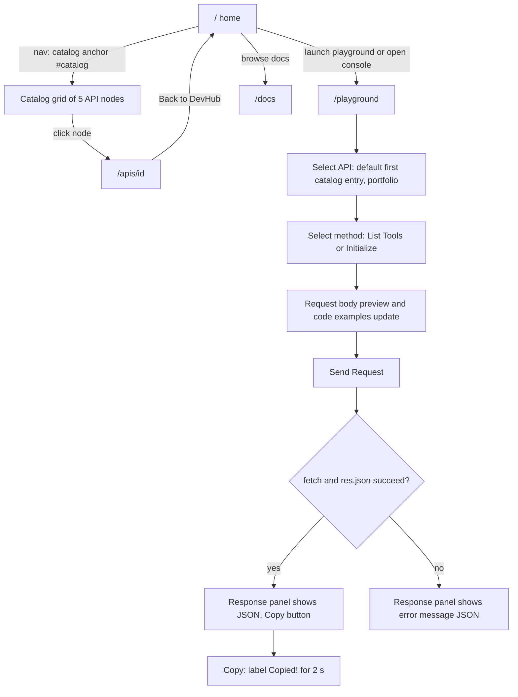
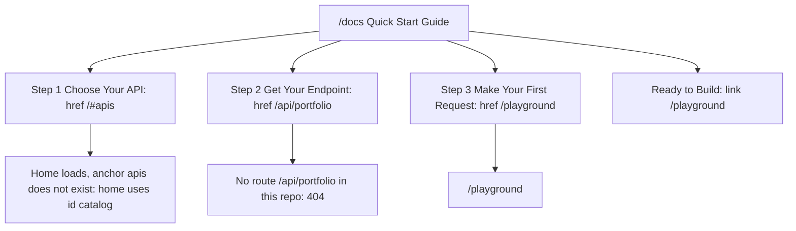
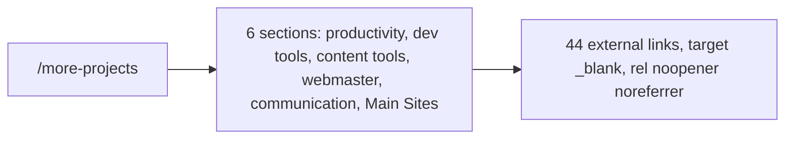

# 03 — User flows

Status: **done** (มี role เดียวในแอป: anonymous visitor)

## Flow A — Discover then try (main journey)

Sources: `src/app/page.tsx` (nav links, `#catalog`, CTA hrefs), `src/app/apis/[id]/page.tsx`, `src/app/playground/page.tsx`

## Flow B — Docs quick start

Sources: `src/app/docs/page.tsx` (`steps[].href`), `src/app/page.tsx` (`id="catalog"`), route tree under `src/app/`

## Flow C — More projects

Sources: `src/app/more-projects/page.tsx`

หมายเหตุ: ไม่มี link ไป `/more-projects` จากหน้าอื่นใน `src/app/` (เข้าถึงผ่าน URL ตรงหรือ `public/sitemap.xml` เท่านั้น)

## Open questions

- ลิงก์ `/#apis` และ `/api/portfolio` ใน `/docs` ควรชี้ไป `/#catalog` และ `/apis/portfolio` หรือไม่ (ต้องแก้โค้ด — นอก scope ของ pack นี้)
- `/more-projects` ตั้งใจให้ซ่อนจาก nav หรือไม่
