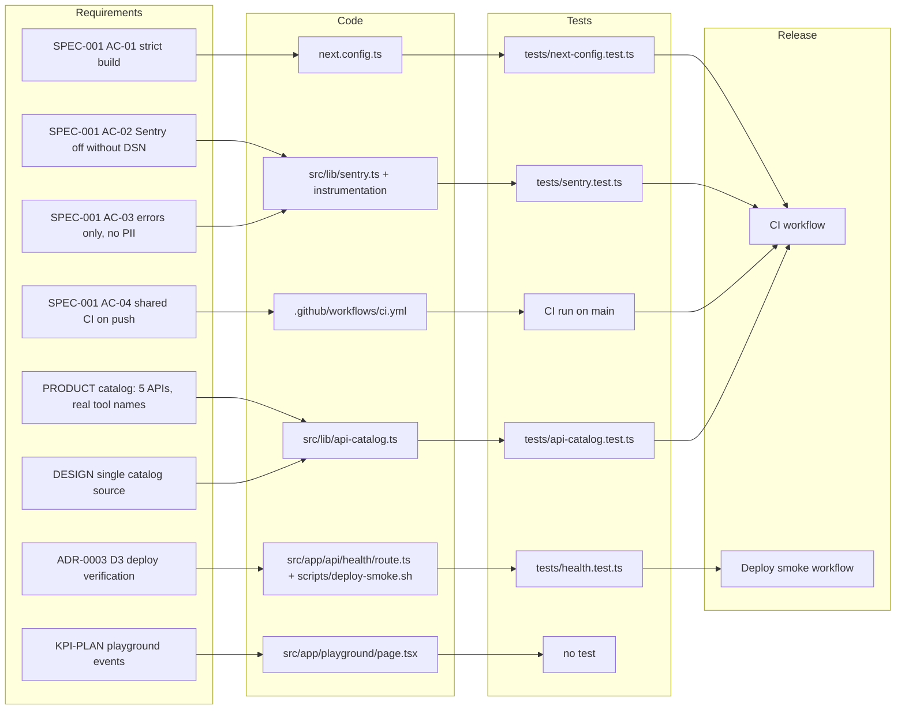

# 04 — Traceability (RTM)

Status: **done**

แหล่ง requirement: `specs/001-strict-build-ci-sentry/spec.md` (AC-01..AC-04), `PRODUCT.md` (catalog/playground claims, improve-next list),
`DESIGN.md` constraints, `docs/measurement/KPI-PLAN.md` (planned events) — reuse KPI-PLAN ไม่คัดลอก

Sources: `specs/001-strict-build-ci-sentry/spec.md`, `PRODUCT.md`, `DESIGN.md`, `docs/measurement/KPI-PLAN.md`, `tests/*.test.ts`,
`.github/workflows/ci.yml`, `.github/workflows/deploy-smoke.yml` (header comment "ADR-0003, D3"), `scripts/deploy-smoke.sh`

| Req ID | Requirement | Code | Test | Release gate | Status |
|---|---|---|---|---|---|
| AC-01 | build ไม่ปิด type/lint error | `next.config.ts` (`{}`) | `tests/next-config.test.ts` | `ci.yml` → `npm run build` | covered |
| AC-02 | Sentry ปิดถ้าไม่มี DSN | `src/lib/sentry.ts` `sentryOptions` | `tests/sentry.test.ts` "stays disabled…" | CI test step | covered |
| AC-03 | errors only, scrub request/user/breadcrumbs/extra/vars/query | `scrubEvent`, `sentryOptions` | `tests/sentry.test.ts` (5 cases) | CI test step | covered |
| AC-04 | shared CI + security pinned v1.1.1 `87dc5e1` | `.github/workflows/ci.yml` | GitHub Actions run | CI | covered (ไม่ block deploy — ดู 18) |
| PRODUCT | 5 APIs, ชื่อ tool ของ portfolio/techspace ตรงจริง, endpoints = tools.length | `src/lib/api-catalog.ts` | `tests/api-catalog.test.ts` | CI | covered (URL ยังมีชีวิตอยู่หรือไม่ ไม่ได้ทดสอบ) |
| DESIGN | หน้า home/detail/playground ใช้ catalog เดียว | `API_CATALOG` imports | ไม่มี test เชิง import (ตรวจด้วยการอ่าน) | — | partial |
| ADR-0003 D3 | prod รัน commit ที่ deploy | `/api/health`, `deploy-smoke.sh` | `tests/health.test.ts` | `deploy-smoke.yml` | covered |
| KPI events | `playground_request_*` | ยังไม่มีใน `playground/page.tsx` | none | — | **gap (planned)** |
| PRODUCT improve #2 | Playground error state | ไม่มี | none | — | **gap** |

## Open questions

- ADR-0003 (D3) อยู่ใน architecture-docs ส่วนกลาง ไม่ได้อยู่ใน repo — link ที่ถูกต้องคือไฟล์ใด
- ไม่มี requirement ID ให้กับ PRODUCT.md claims — ต้องการ spec 002 สำหรับ Playground error state/events หรือไม่
