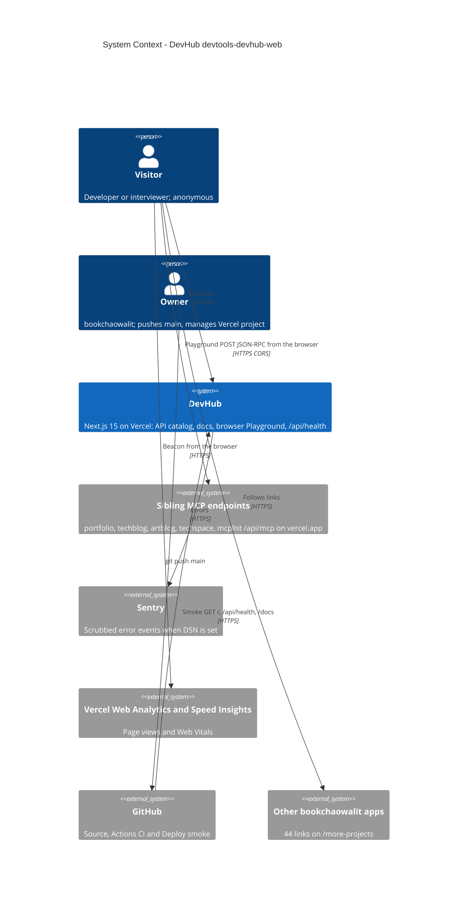

# 05 — C4 Context

Status: **done**

Sources: `src/app/layout.tsx` (`Analytics`, `SpeedInsights`), `src/instrumentation.ts`, `src/instrumentation-client.ts`, `src/lib/api-catalog.ts` (`url`),
`src/app/playground/page.tsx` (`fetch`), `src/app/more-projects/page.tsx`, `.github/workflows/*.yml`, `scripts/deploy-smoke.sh`

จุดสำคัญ: Playground เรียก sibling **จาก browser ของ visitor โดยตรง** ไม่ผ่าน server ของ DevHub (ไม่มี proxy route) — ดังนั้นความสำเร็จขึ้นกับ CORS ของ sibling

## Open questions

- Sentry project สำหรับ repo นี้ชื่ออะไร (env `NEXT_PUBLIC_SENTRY_DSN` ตั้งใน Vercel production+preview แล้วตาม Vercel project API, 2026-11-03 แต่ไม่ได้ยืนยันว่า event เข้า)
