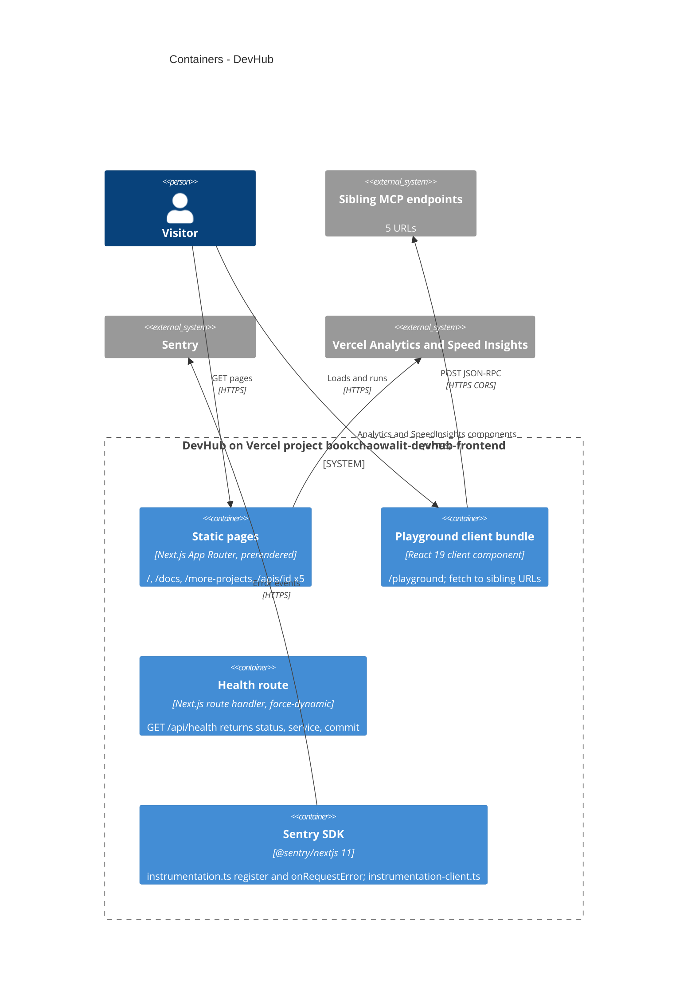

# 06 — C4 Container

Status: **done**

Sources: `src/app/page.tsx`, `src/app/docs/page.tsx`, `src/app/more-projects/page.tsx`, `src/app/apis/[id]/page.tsx` (`generateStaticParams`, `dynamicParams = false`),
`src/app/playground/page.tsx` (`'use client'`), `src/app/api/health/route.ts` (`dynamic = "force-dynamic"`), `src/instrumentation.ts`, `src/instrumentation-client.ts`,
`src/app/layout.tsx`, `package.json`

ไม่มี container ข้อมูล (DB, KV, blob) และไม่มี API ของตัวเองนอกจาก `/api/health`

## Open questions

- ไม่มี `withSentryConfig` ใน `next.config.ts` จึงไม่มี source map upload — ตั้งใจหรือไม่
