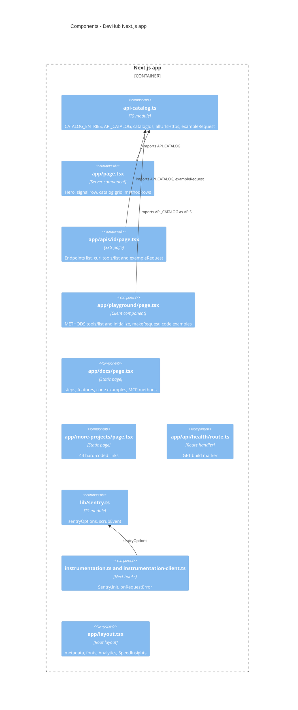

# 07 — C4 Component

Status: **done**

Sources: ไฟล์ทั้งหมดที่ระบุใน diagram, `src/lib/utils.ts` (`cn`, ไม่ได้ใช้ในหน้าใดที่อ่าน)

หมายเหตุ: `docs/page.tsx` ไม่ import `API_CATALOG` — hard-code URL portfolio และข้อความ "5 APIs" เอง (drift risk เดียวกับที่ PRODUCT.md ข้อ 4 เตือน)

## Open questions

- ควรให้ `/docs` ใช้ `API_CATALOG` ด้วยหรือไม่
