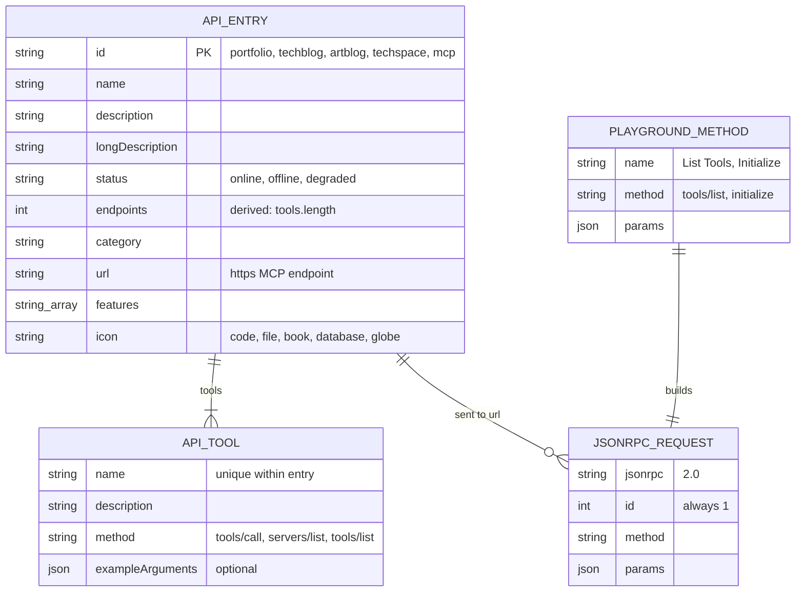

# 09 — ERD

Status: **done (in-code data model, no database)**

ไม่มีข้อมูล persisted ฝั่ง DevHub (ไม่มี DB/ORM/migration/KV/localStorage) — model เดียวคือ type ของ catalog ใน `src/lib/api-catalog.ts`
และ request/response shape ที่ Playground ส่ง (ไม่เก็บ)

Sources: `src/lib/api-catalog.ts` (`ApiEntry`, `ApiTool`, `CATALOG_ENTRIES`, `exampleRequest`), `src/app/playground/page.tsx` (`METHODS`, `requestBody`), `tests/api-catalog.test.ts` (uniqueness, counts)

| Entry id | tools (count) |
|---|---|
| portfolio | 6 |
| techblog | 3 |
| artblog | 3 |
| techspace | 7 |
| mcp | 3 |
| **total** | **22** |

หมายเหตุ: PRODUCT.md (2026-08-05) เขียนว่า "5 APIs, 21 endpoints" แต่ catalog ปัจจุบันรวม 22 (หน้า home คำนวณเอง จึงแสดง 22)

## Open questions

- ไม่มี — ไม่มีข้อมูลผู้ใช้ให้เก็บ
