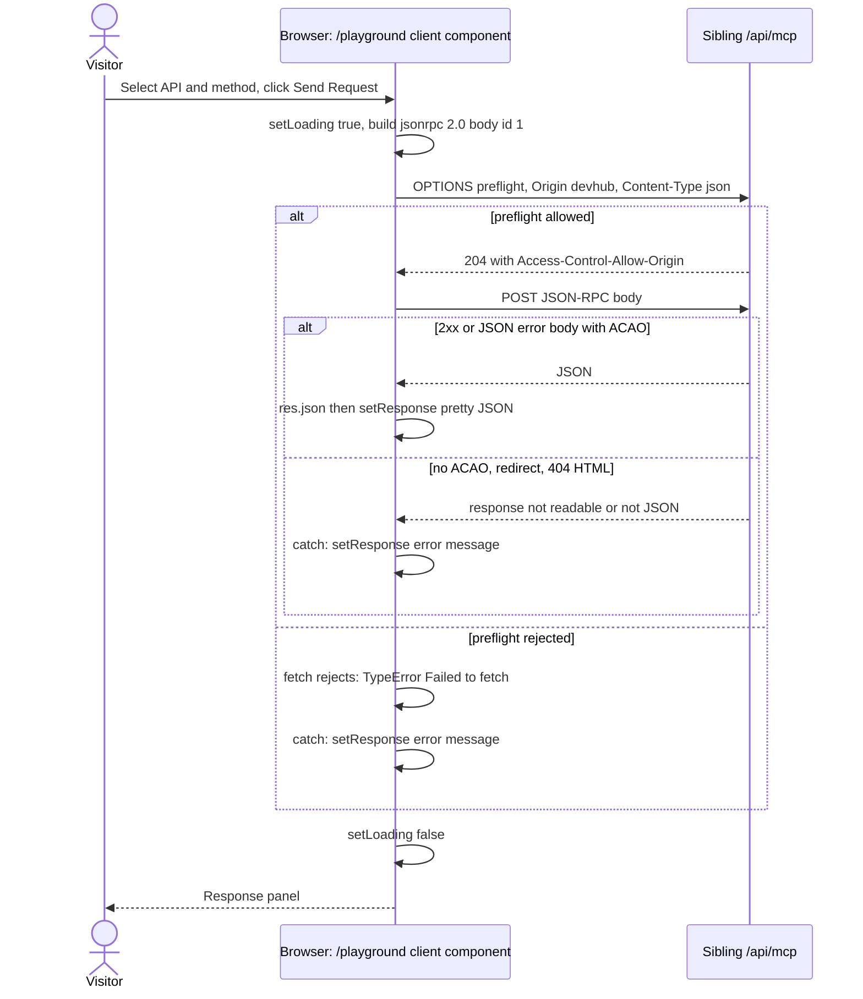
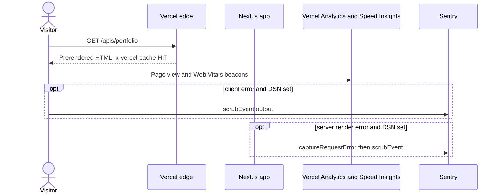
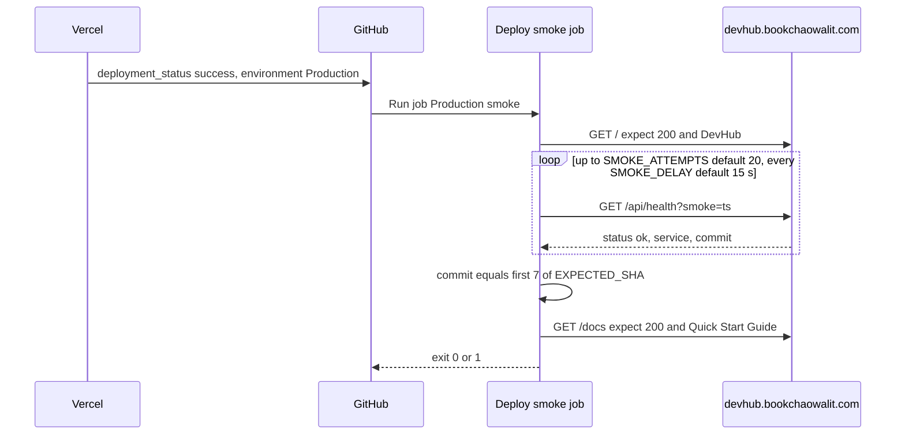

# 10 — Sequences

Status: **done** (3 request paths ที่สำคัญที่สุด)

## S1 — Playground live request

Sources: `src/app/playground/page.tsx` (`makeRequest`), `PRODUCT.md` (preflight chain), live probe 2026-11-03 (ดู 12)

หมายเหตุ: ไม่มีการตรวจ `res.ok` — HTTP 406 ที่มี JSON body (techspace) จะแสดงเป็น "response" ปกติ ไม่ใช่ error

## S2 — Page view with analytics and errors

Sources: `src/app/layout.tsx`, `src/app/apis/[id]/page.tsx`, `src/instrumentation.ts`, `src/instrumentation-client.ts`, `src/lib/sentry.ts`, response header `x-vercel-cache: HIT` (curl 2026-11-03)

## S3 — Post-deploy smoke

Sources: `.github/workflows/deploy-smoke.yml`, `scripts/deploy-smoke.sh`, `src/app/api/health/route.ts`

## Open questions

- ไม่มี
