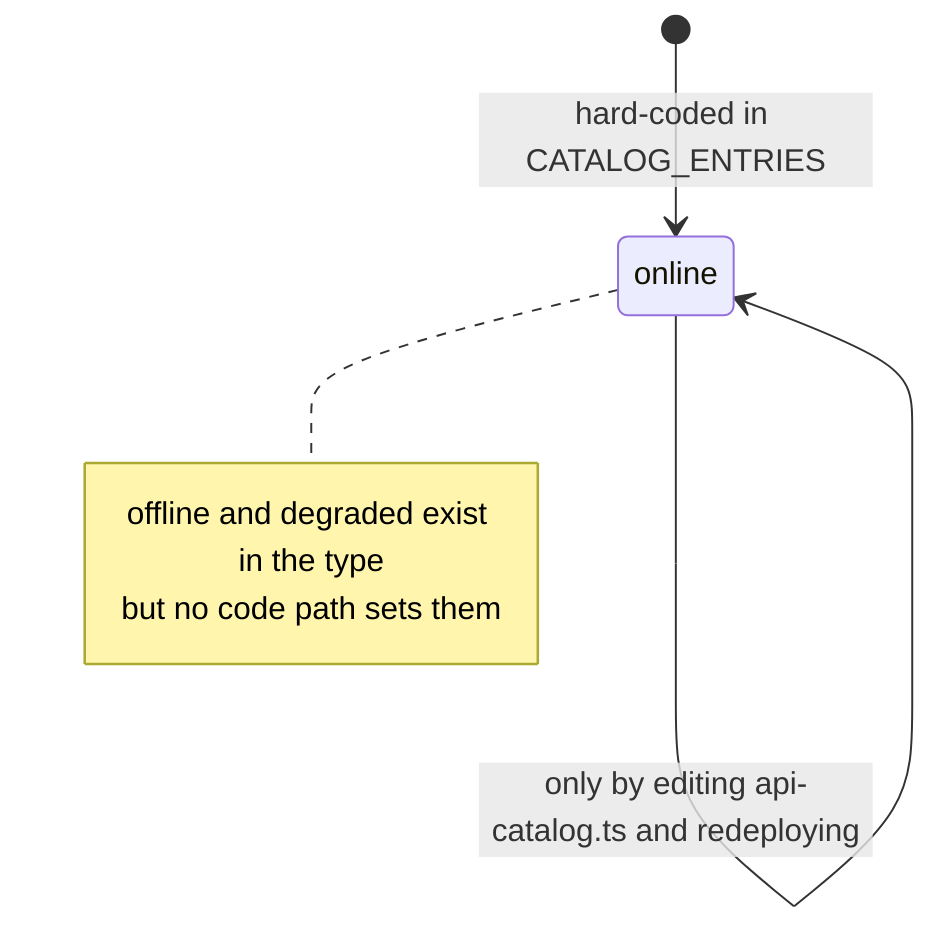
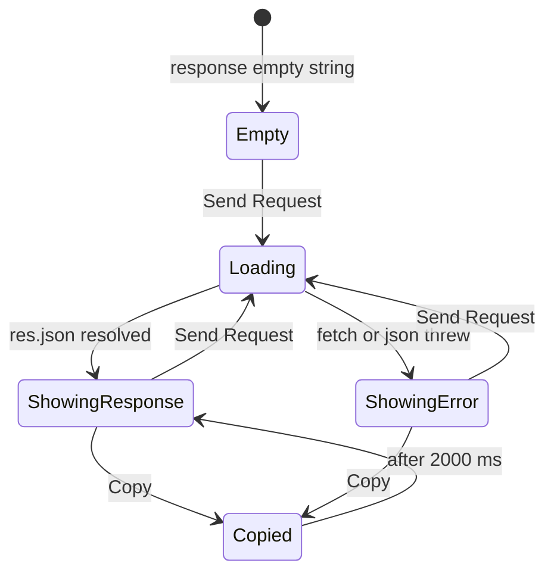
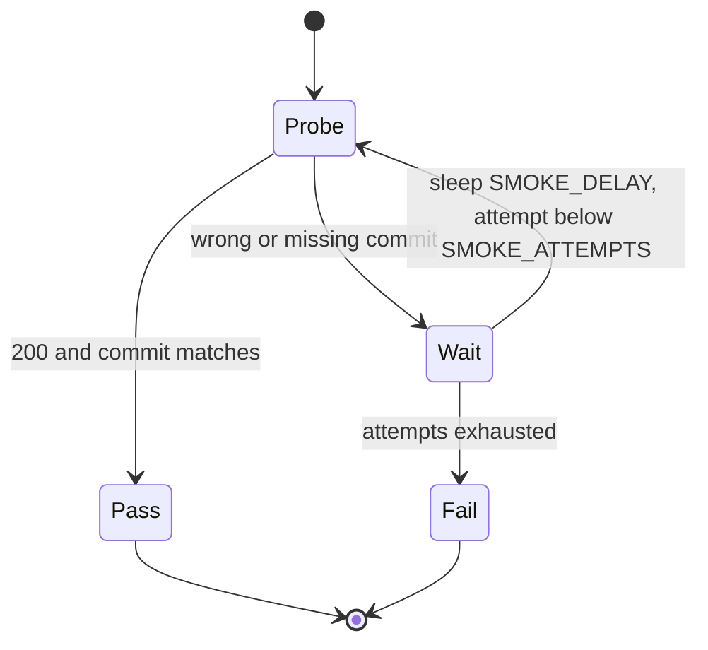

# 11 — State machines

Status: **done**

## ApiEntry.status

field `status: "online" | "offline" | "degraded"` มีใน type แต่ **ไม่มีโค้ดที่เปลี่ยนค่า** — ทั้ง 5 entry ตั้งเป็น `"online"` แบบ hard-code และหน้า home แสดงค่านี้ตรงๆ (ไม่มี health probe)

Sources: `src/lib/api-catalog.ts`, `src/app/page.tsx` (`api.status`)

## Playground request (UI state)

Sources: `src/app/playground/page.tsx` (`loading`, `response`, `copied`, `setTimeout 2000`)

หมายเหตุ: ปุ่ม Send ถูก `disabled` ระหว่าง Loading; เปลี่ยน API/method ไม่ล้าง response เดิม (state `response` ไม่ถูก reset ใน `onChange`) — ทำให้ response อาจไม่ตรงกับ API ที่เลือกอยู่

## Deploy smoke health wait

Sources: `scripts/deploy-smoke.sh`

## Open questions

- ควรมี health probe เพื่อตั้ง `status` จริงหรือไม่ (DESIGN.md: "Do not claim uptime or performance that the product does not measure" — ป้าย "online" ตอนนี้เป็น claim ที่ไม่ได้วัด)
