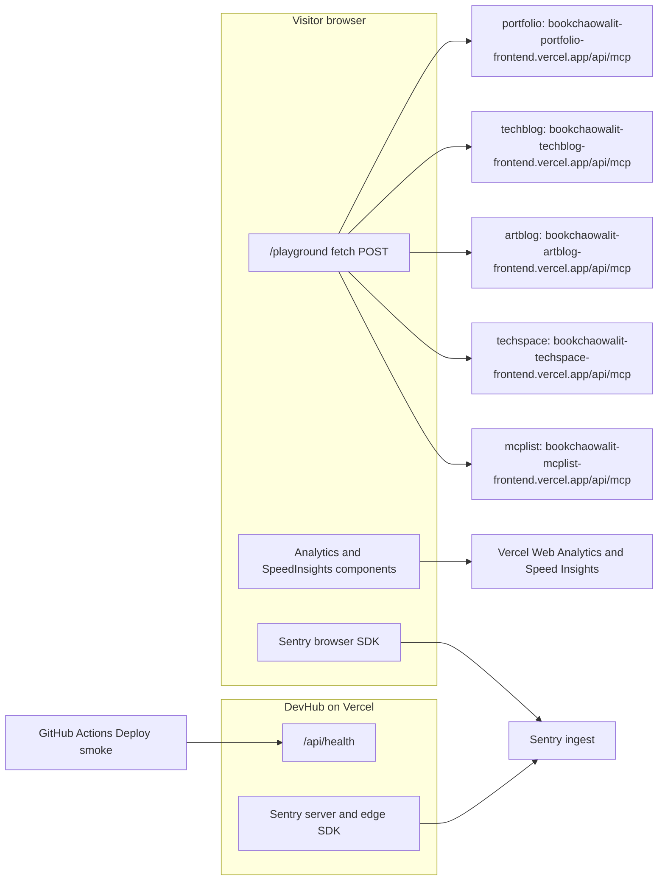

# 12 — API & integrations

Status: **done**

## Endpoints ของ DevHub เอง

| Method | Path | Handler | Response |
|---|---|---|---|
| GET | `/api/health` | `src/app/api/health/route.ts` | `{"status":"ok","service":"devtools-devhub-web","commit":<7-char VERCEL_GIT_COMMIT_SHA or null>}`, `cache-control: no-store` |

ไม่มี endpoint อื่น (route `/api/mcp` ที่ `methodRows` บนหน้า home แสดง เป็นของ sibling ไม่ใช่ของ DevHub)

## Integrations



Sources: `src/lib/api-catalog.ts` (`url`), `src/app/playground/page.tsx`, `src/app/layout.tsx`, `src/instrumentation*.ts`, `src/app/api/health/route.ts`, `scripts/deploy-smoke.sh`

## Live probe of sibling endpoints (2026-11-03)

คำสั่ง (read-only, ต่อ URL):

```bash
curl -s -o /dev/null -w '%{http_code}' -X OPTIONS -H 'Origin: https://devhub.bookchaowalit.com' \
  -H 'Access-Control-Request-Method: POST' -H 'Access-Control-Request-Headers: content-type' -D - "$URL"
curl -s -X POST -H 'Origin: https://devhub.bookchaowalit.com' -H 'content-type: application/json' \
  -d '{"jsonrpc":"2.0","id":1,"method":"tools/list","params":{}}' -D - "$URL"
```

| Catalog id | OPTIONS | POST tools/list | ACAO | Playground ใช้ได้? |
|---|---|---|---|---|
| portfolio | 404 | 404 | none | **no** — vercel.app alias ไม่อยู่ใน project แล้ว; project `bookchaowalit-portfolio-frontend` มีโดเมน `bookchaowalit.com` ซึ่ง OPTIONS `/api/mcp` ตอบ 204 + `*` |
| techblog | 204 | 200 | `*` | yes |
| artblog | 308 → `/api/mcp/` | 308 | none | **no** — browser ไม่ตาม redirect ใน preflight |
| techspace | 204 | 406 "Client must accept both application/json and text/event-stream" | `*` | **no** — แสดง JSON error ใน panel |
| mcp | 204 | 200 | `https://devhub.bookchaowalit.com` | yes (allowlist ใน `devtools-mcplist-web/lib/cors.ts`) |

## Third-party SDKs

| Package | ใช้ที่ | ข้อมูลที่ส่ง |
|---|---|---|
| `@vercel/analytics` | `layout.tsx` `<Analytics />` | page view (cookieless ตาม KPI-PLAN) |
| `@vercel/speed-insights` | `layout.tsx` `<SpeedInsights />` | Web Vitals |
| `@sentry/nextjs` ^11.8.0 | `instrumentation*.ts` | error events หลัง `scrubEvent` |
| `next/font/google` Geist, Geist_Mono | `layout.tsx` | self-host ตอน build (ไม่มี request ไป Google ตอน runtime ตามพฤติกรรม next/font) |

## Open questions

- จะแก้ catalog URL portfolio เป็น `https://bookchaowalit.com/api/mcp`, artblog เป็น `/api/mcp/` และเพิ่ม `Accept: application/json, text/event-stream` ใน Playground หรือไม่ (ต้องแก้โค้ด)
- หน้า home hero แสดง `POST https://api.bookchaowalit.com/mcp` และ response "12 projects · 118ms" เป็นตัวอย่างประกอบ ไม่ใช่ endpoint ใน catalog — ควรติดป้ายว่า illustrative หรือไม่
