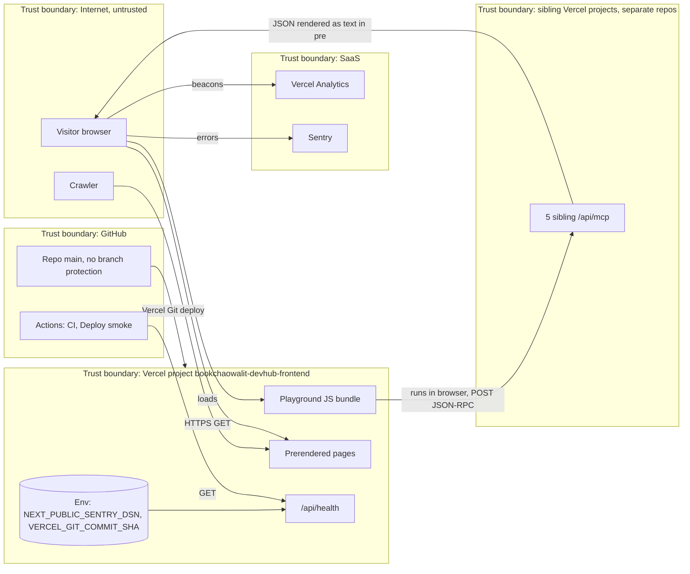

# 13 — Threat model (DFD + STRIDE)

Status: **done**

Sources: `src/app/**`, `src/lib/sentry.ts`, `src/instrumentation*.ts`, `src/app/api/health/route.ts`, `.github/workflows/*.yml`, `osv-scanner.toml`, GitHub branch protection API (404), Vercel project API (`ssoProtection: all_except_custom_domains`), live headers 2026-11-03

## STRIDE per element

| Element | S | T | R | I | D | E | Mitigations in code/config | Gaps |
|---|---|---|---|---|---|---|---|---|
| Prerendered pages | — | supply-chain into build | — | none secret on page | Vercel CDN | — | `ci.yml` security: gitleaks, semgrep, osv-scanner, trivy-fs; SHA-pinned reusable workflows; `osv-scanner.toml` reviewed exceptions with expiry | no CSP, X-Frame-Options or Referrer-Policy (only HSTS seen live) |
| Playground bundle | — | — | — | request body ไม่มีข้อมูลผู้ใช้ (method fixed: `tools/list`, `initialize`) | — | — | response แสดงผ่าน `{response}` ใน `<pre>` (React escape, ไม่มี `dangerouslySetInnerHTML`) | sibling ที่ถูกยึดอาจส่งข้อมูลหลอกให้ผู้ชม (spoofing ของเนื้อหา) — ไม่มีการตรวจ |
| Sibling endpoints (TB2) | domain takeover ของ vercel.app alias ที่ไม่ได้ผูกแล้ว (portfolio 404) | — | — | — | DevHub ไม่ควบคุม uptime | — | ADR-0002: ไม่มี server proxy จึงไม่มี SSRF/open proxy | catalog URL ไม่ถูกตรวจใน CI |
| `/api/health` | — | — | — | เปิดเผย commit 7 ตัว (repo public อยู่แล้ว) | `force-dynamic`, no I/O | — | `cache-control: no-store` | ไม่มี rate limit (Vercel defaults) |
| Sentry flow | — | — | — | URL query, user, breadcrumbs | — | — | `scrubEvent` + `sendDefaultPii: false` + tests | DSN เป็น public (`NEXT_PUBLIC_`) — ใครก็ส่ง event ปลอมได้ (ธรรมชาติของ Sentry DSN) |
| GitHub main | push ด้วย token ที่รั่ว | ไม่มี branch protection, CI ไม่ gate deploy | git history | — | — | — | gitleaks ใน CI; `deploy-smoke.yml` `persist-credentials: false`, `permissions: contents: read` | CI แดงก็ deploy (ADR-0003) |
| Vercel env | — | — | Vercel audit log | DSN เท่านั้น ไม่มี secret อื่น | — | — | ไม่มี secret server-side ใน repo | — |
| Preview deployments | — | — | — | — | — | — | Vercel Deployment Protection `all_except_custom_domains` | — |

## Open questions

- ต้องการ security headers (CSP, frame-ancestors) ผ่าน `next.config.ts` `headers()` หรือไม่
- ควร claim vercel.app alias เก่าของ portfolio ไว้ หรือเลิกชี้ไป (เสี่ยง takeover ถ้าชื่อ project ว่าง)
- ต้องการเปิด branch protection / required checks บน `main` หรือไม่
