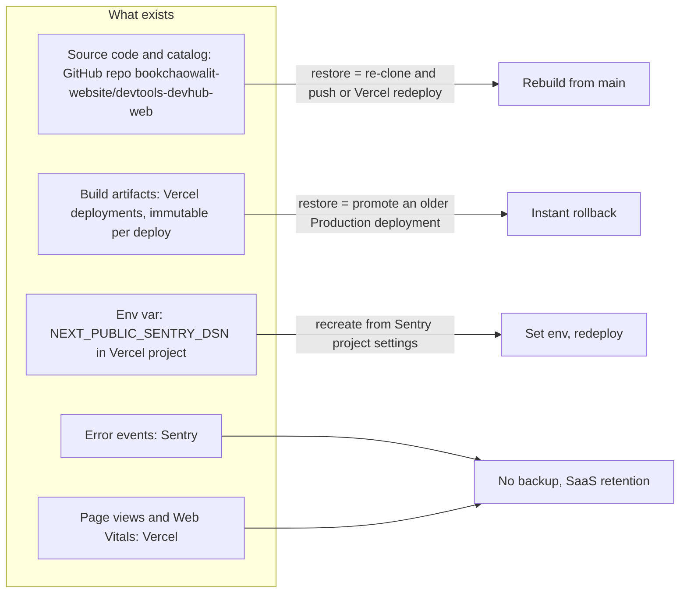

# 14 — Backup & DR

Status: **done** (ไม่มีข้อมูล runtime ให้ backup — static site + health route)

Sources: `src/lib/api-catalog.ts` (data is code), `specs/001-strict-build-ci-sentry/spec.md` §4 (DSN), Vercel project API (env keys, git link), `vercel ls bookchaowalit-devhub-frontend --prod` (8 retained Production deployments, oldest 204 days)

| Data | Location | Backup reality | Restore |
|---|---|---|---|
| Code + catalog | GitHub (+ local clones) | Git itself; ไม่มี mirror workflow ใน repo | push / clone |
| Deployments | Vercel | Vercel เก็บ deployment เก่าไว้ (เห็น 8 รายการ Production) | `vercel promote <deployment-url>` หรือ Instant Rollback ใน dashboard |
| Env var | Vercel | ไม่มีสำเนาใน repo (ถูกต้อง); แหล่งจริงคือ DSN ใน Sentry project | ตั้งใหม่ แล้ว **redeploy** เพราะ `NEXT_PUBLIC_*` ถูก inline ตอน build |
| Sentry/Analytics | SaaS | ไม่มี | — |

นอก scope ของ ADR-0002 (central) nightly DB backup เพราะไม่มี DB

**RTO / RPO: not defined** ใน repo (`RUNBOOK.md` Rollback เป็น stub ทั่วไป "Redeploy previous container image / previous git tag" ซึ่งไม่ตรงกับ repo นี้ — ไม่มี container และไม่มี git tag)

## Open questions

- RTO/RPO เป้าหมายสำหรับ Tier A showcase (เสนอ: RPO = last commit on main, RTO = เวลา promote)
- ยังไม่เคยทดสอบ rollback ของ project นี้ (ไม่พบหลักฐาน)
