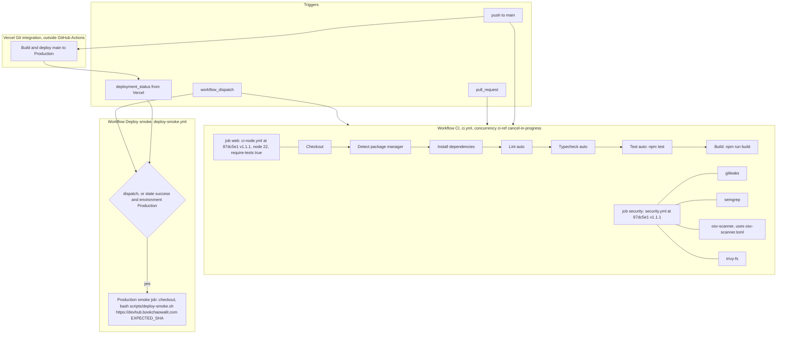

# 15 — CI/CD pipeline

Status: **done**

Sources: `.github/workflows/ci.yml`, `.github/workflows/deploy-smoke.yml`, `scripts/deploy-smoke.sh`, `package.json` (`test`, `build`, `lint`),
`bookchaowalit/platform-ci-workflows` `.github/workflows/ci-node.yml` และ `security.yml` @ `87dc5e1c7e0416886a6371d5a101bb2ccba38edd` (อ่านผ่าน GitHub API), `osv-scanner.toml`

ไม่มีเส้นจาก CI ไป Vercel — สองฝั่งรันขนานกัน (ADR-0003)

## Recent runs (`gh run list -L 200`)

| Workflow | success | failure | cancelled |
|---|---|---|---|
| CI | 5 | 2 (`c646acf` 2026-10-21, `6a4357d` 2026-10-24 osv-scanner Scan) | 1 |
| Deploy smoke | 3 | 0 | 0 |

## Open questions

- Vercel Node.js 24.x (project setting) vs CI node 22 — ต้องการให้ตรงกันหรือไม่
