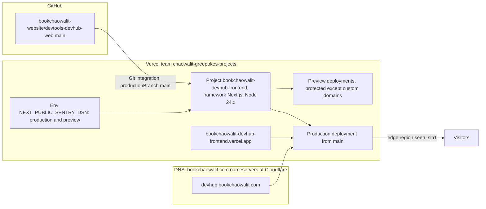

# 16 — Deployment

Status: **done**

Sources: Vercel project API `/v9/projects/bookchaowalit-devhub-frontend` and `/domains` (2026-11-03: link github, `productionBranch: main`, domains `devhub.bookchaowalit.com` and `bookchaowalit-devhub-frontend.vercel.app`, env key list, `ssoProtection`),
`vercel domains inspect devhub.bookchaowalit.com` (Cloudflare nameservers), live headers (`server: Vercel`, `x-vercel-id: sin1::…`, no `cf-ray`), `.github/workflows/deploy-smoke.yml`

| Item | Value |
|---|---|
| Hosting | Vercel (no `vercel.json` in repo — defaults) |
| Production URL | https://devhub.bookchaowalit.com |
| Build | Next.js default `npm run build` |
| Runtime | prerendered pages + `/api/health` dynamic function |
| Data stores | none |

Drift ที่พบ: `layout.tsx` `metadataBase` / `canonical` / OpenGraph `url` ชี้ `https://bookchaowalit-devhub-frontend.vercel.app`; `public/sitemap.xml` ชี้ `https://bookchaowalit-devhub.vercel.app` (host อื่น); `public/robots.txt` Sitemap ชี้ `https://bookchaowalit.com/sitemap.xml`; `/og-image.png` ไม่มีใน `public/` (live 404)

## Open questions

- Cloudflare record ของ `devhub` เป็น DNS-only (ไม่เห็น `cf-ray`) — ยืนยันว่าตั้งใจ
- canonical ควรเป็น `https://devhub.bookchaowalit.com` หรือไม่
