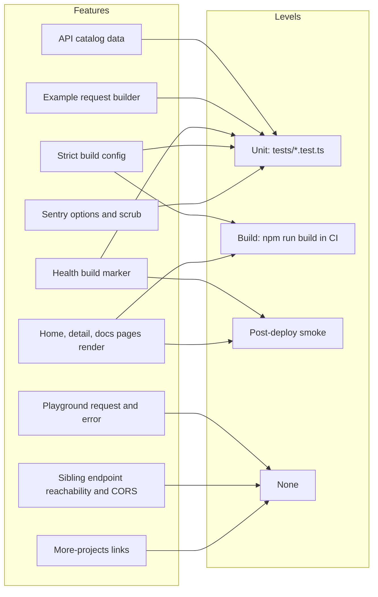

# 17 — Test coverage matrix

Status: **done**

Test runner: `node --experimental-strip-types --test tests/**/*.test.ts` (`package.json` `test`) — มีแค่ unit test 4 ไฟล์; ไม่มี integration/e2e (ไม่มี Playwright/Cypress ใน `package.json`) ไม่มี coverage gate (`ci.yml` ไม่ส่ง `coverage-threshold`)

Sources: `package.json`, `tests/api-catalog.test.ts`, `tests/health.test.ts`, `tests/next-config.test.ts`, `tests/sentry.test.ts`, `.github/workflows/ci.yml`, `scripts/deploy-smoke.sh`

| Feature | Unit | Integration | E2E / smoke | Test file / check |
|---|---|---|---|---|
| Catalog ids, https URLs, counts, unique tool names, portfolio + techspace tool names | yes | — | — | `tests/api-catalog.test.ts` |
| `exampleRequest` (tools/call vs protocol method, roll_dice args) | yes | — | — | `tests/api-catalog.test.ts` |
| `/api/health` body, no-store, commit/null | yes | — | smoke step 2 | `tests/health.test.ts`, `deploy-smoke.sh` |
| `next.config.ts` strict | yes | — | build | `tests/next-config.test.ts` |
| Sentry disabled without DSN, errors-only, scrub (4 cases) | yes | — | — | `tests/sentry.test.ts` |
| Home renders "DevHub" | — | — | smoke step 1 | `deploy-smoke.sh` `HOME_MARKER` |
| `/docs` renders "Quick Start Guide" | — | — | smoke step 3 | `deploy-smoke.sh` `MAIN_MARKER` |
| `/apis/[id]` x5 | — | — | build only (SSG) | — **gap** |
| Playground send/response/error/copy | — | — | — | **gap** |
| Sibling URL alive + CORS | — | — | — | **gap** (3 of 5 fail live 2026-11-03) |
| Internal links (`/#apis`, `/api/portfolio`) | — | — | — | **gap** (both broken) |
| `/more-projects` 44 external links | — | — | — | **gap** |

## Open questions

- ต้องการ scheduled check ของ 5 sibling endpoints (OPTIONS + POST จาก Origin devhub) หรือไม่
