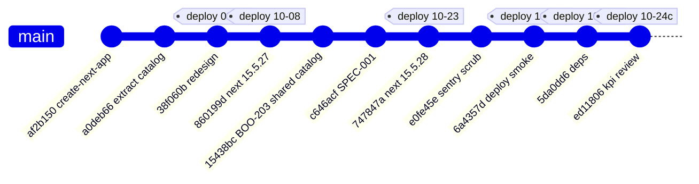
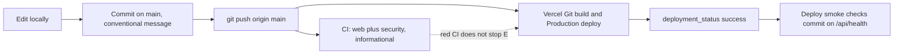

# 18 — Git & release workflow

Status: **done**

repo ใช้ main-only: ไม่มี merge commit (`git log --merges` ว่าง), ไม่มี PR (`gh pr list --state all` ว่าง), ไม่มี git tag, ไม่มี branch protection

Sources: `git log origin/main`, `gh pr list --state all`, GitHub branch protection API (404), `.github/workflows/ci.yml`, `.github/workflows/deploy-smoke.yml`,
`vercel ls bookchaowalit-devhub-frontend --prod --format json` (deployment `meta.githubCommitSha`) — tag ใน gitGraph คือ Production deployment ไม่ใช่ git tag

หมายเหตุ: deploy 2026-10-23 (`747847a`) ไม่มี GitHub Deployment record (มีเฉพาะ 3 รายการ 2026-10-24) จึงน่าจะเป็น CLI deploy ก่อน Git relink; commit `4cfd85c`/`e0fe45e` ขึ้น prod พร้อม deploy `6a4357d`

## Open questions

- ต้องการ PR + required checks ก่อน deploy หรือคง main-only
