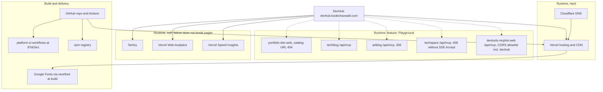

# 19 — Service dependency map

Status: **done**

Sources: `src/lib/api-catalog.ts`, `src/app/layout.tsx`, `src/instrumentation*.ts`, `package.json`, `.github/workflows/ci.yml`, Vercel project API, live probe 2026-11-03 (12), external read-only `devtools-mcplist-web/lib/cors.ts`

เส้นประ = ใช้จาก browser ของ visitor ไม่ใช่ server ของ DevHub

## Open questions

- `MCP List Hub` อธิบายตัวเองว่า "proxy" ไปยัง server อื่น — dependency ทางอ้อมของ hub ไม่ได้วาดที่นี่ (อยู่ใน repo mcplist)
