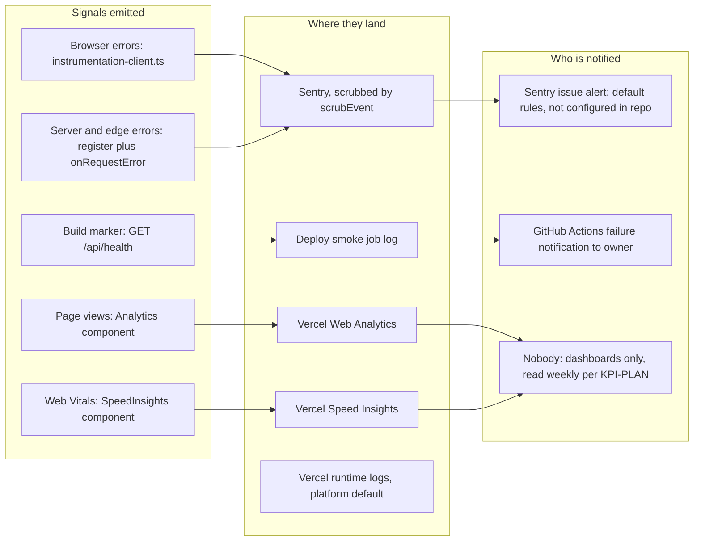

# 20 — Observability

Status: **done** (reuse [docs/measurement/KPI-PLAN.md](../measurement/KPI-PLAN.md) สำหรับ KPI/alert targets)

Sources: `src/instrumentation.ts`, `src/instrumentation-client.ts`, `src/lib/sentry.ts`, `src/app/layout.tsx`, `src/app/api/health/route.ts`, `.github/workflows/deploy-smoke.yml`, `docs/measurement/KPI-PLAN.md` (Dashboards and alerts: "Alerts reach the channel — not set up")

## What is not watched

| Gap | Evidence |
|---|---|
| ไม่อยู่ใน uptime monitor กลาง | `platform-uptime-worker/src/targets.ts` ไม่มี `devhub` (grep 2026-11-03) |
| ไม่มี heartbeat | ไม่มี scheduled job ใน repo |
| sibling endpoints ไม่มี probe | ไม่มีใน CI/smoke |
| Playground success rate | events `playground_request_*` = planned (KPI-PLAN) |
| Sentry event เข้าจริงหรือไม่ | env `NEXT_PUBLIC_SENTRY_DSN` มีใน Vercel (production, preview) แต่ไม่ได้ยืนยัน event |
| Analytics enablement | KPI-PLAN review 2026-10-24: "project-side enablement is unverified"; Vercel project API มี `webAnalytics.id` และ `speedInsights` object (2026-11-03) |

## Open questions

- เพิ่ม `devhub.bookchaowalit.com/api/health` เข้า `platform-uptime-worker` targets หรือไม่
- Sentry alert rule และปลายทาง (email/Telegram) ของ project นี้คืออะไร
