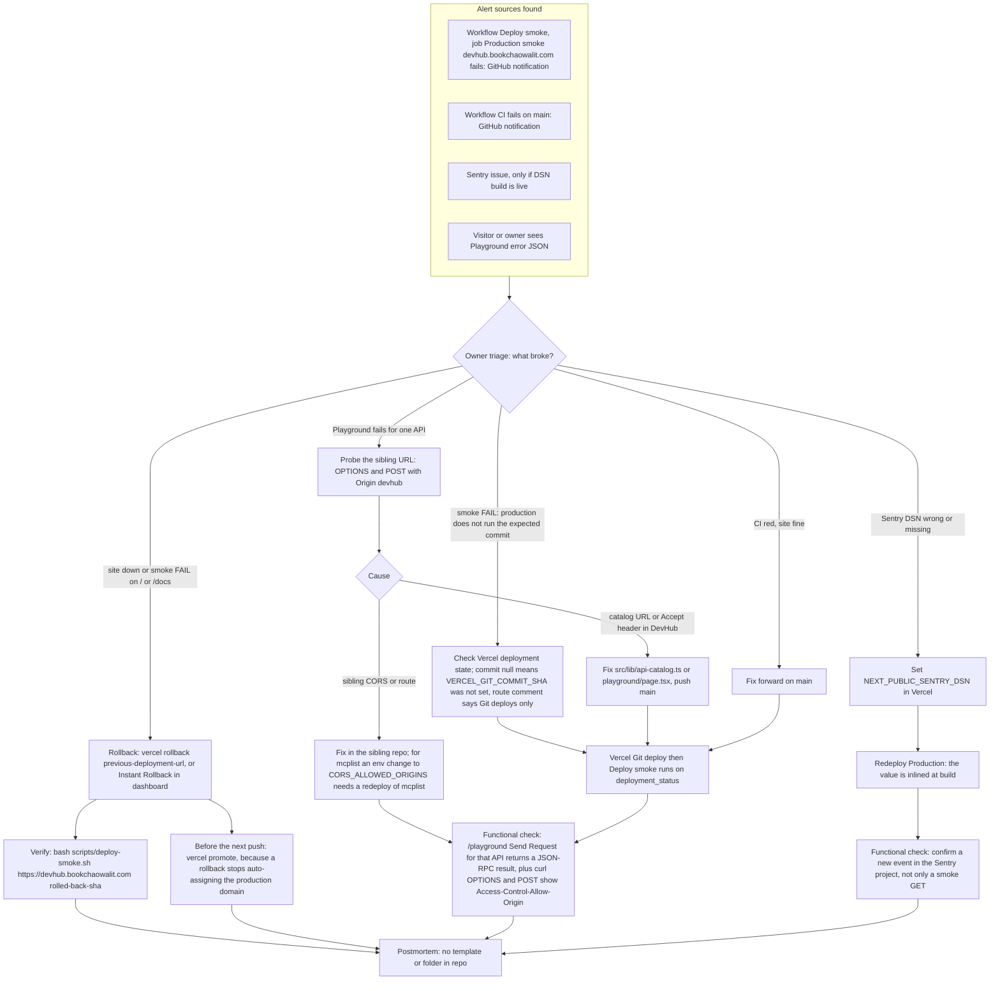

# 21 — Incident response

Status: **done** (ช่องทางที่พบจริงเท่านั้น; ไม่มี on-call — `RUNBOOK.md` "Solo operator (bookchaowalit). No multi-person on-call.")

Sources: `.github/workflows/deploy-smoke.yml` (workflow `Deploy smoke`, job name `Production smoke (devhub.bookchaowalit.com)`, `EXPECTED_SHA: github.event.deployment.sha || github.sha`), `.github/workflows/ci.yml` (workflow `CI`),
`scripts/deploy-smoke.sh` (args `<base-url> [expected-commit]`, env `SMOKE_ATTEMPTS` default 20, `SMOKE_DELAY` default 15, messages `::error::FAIL …`), `src/app/api/health/route.ts` (commit null on non-Git deploys),
`src/lib/sentry.ts` / `src/instrumentation*.ts` (`NEXT_PUBLIC_SENTRY_DSN`), `src/app/playground/page.tsx`, `src/lib/api-catalog.ts`, `RUNBOOK.md`, Vercel CLI 64.5.0 `vercel rollback --help` / `vercel promote --help`, external read-only `devtools-mcplist-web/lib/cors.ts` (`CORS_ALLOWED_ORIGINS`)

## ข้อควรระวังที่มาจากโค้ดจริง

- **smoke ไม่ตรวจ Playground หรือ sibling** — `deploy-smoke.sh` GET แค่ `/`, `/api/health`, `/docs` ผ่านได้แม้ Playground ใช้ไม่ได้ทั้ง 5 API ต้องเช็คเชิง functional ด้วยการกด Send Request จริงและ curl CORS (คำสั่งใน [12](12-api-integration.md))
- **หลัง rollback ห้าม dispatch Deploy smoke เพื่อยืนยัน** — manual run ใช้ `github.sha` (head ของ main) จึงจะ FAIL โดยออกแบบ ให้รัน script เองพร้อม sha ของ deployment ที่ rollback ไป; rollback ไม่สร้าง deployment ใหม่ จึงไม่มี `deployment_status` มาเรียก smoke ให้เอง
- **deploy ที่ไม่มี `VERCEL_GIT_COMMIT_SHA` ทำให้ smoke step 2 FAIL เสมอ** — `/api/health` คืน `commit: null` และ script ต้องการ commit เสมอแม้ไม่ส่ง expected; comment ใน route และ `tests/health.test.ts` ระบุว่า CLI deploy ไม่มีค่านี้ (ยังไม่ได้ยืนยันกับ CLI deploy จริง — Vercel API แสดง `meta.githubCommitSha` แม้ deploy 2026-10-23 ที่ไม่มี GitHub Deployment record)
- **เปลี่ยน env ต้อง redeploy** — `NEXT_PUBLIC_SENTRY_DSN` ถูก inline ตอน build; ตั้งค่าแล้วไม่ redeploy = ไม่มีผล และ smoke GET ไม่บอกว่า Sentry ทำงาน
- `RUNBOOK.md` Rollback ("Redeploy previous container image / previous git tag") ไม่ตรงกับ repo นี้ (ไม่มี container/tag) — ใช้ขั้นตอน Vercel ข้างบนแทน
- ข้อความ "auto-assign ปิดหลัง rollback" มาจากพฤติกรรม Vercel Instant Rollback (เอกสาร Vercel) ไม่ใช่โค้ดใน repo — ควรยืนยันในการ drill ครั้งแรก

## Severity

ไม่พบ severity matrix หรือ SLA — **not defined** (`CLASSIFICATION.md`: "Do not claim … uptime SLAs")

## Open questions

- ต้องการ postmortem template และที่เก็บ (`docs/incidents/`) หรือไม่
- ยังไม่มี route ทดสอบ Sentry — จะยืนยัน DSN ด้วยวิธีใด (เช่น error ที่ตั้งใจใน preview)
- ใครดูแล sibling repo เมื่อ Playground พังเพราะ sibling (ทั้งหมดเป็นของ owner แต่ CI ของแต่ละ repo ไม่รู้ว่า DevHub พึ่งพา)
