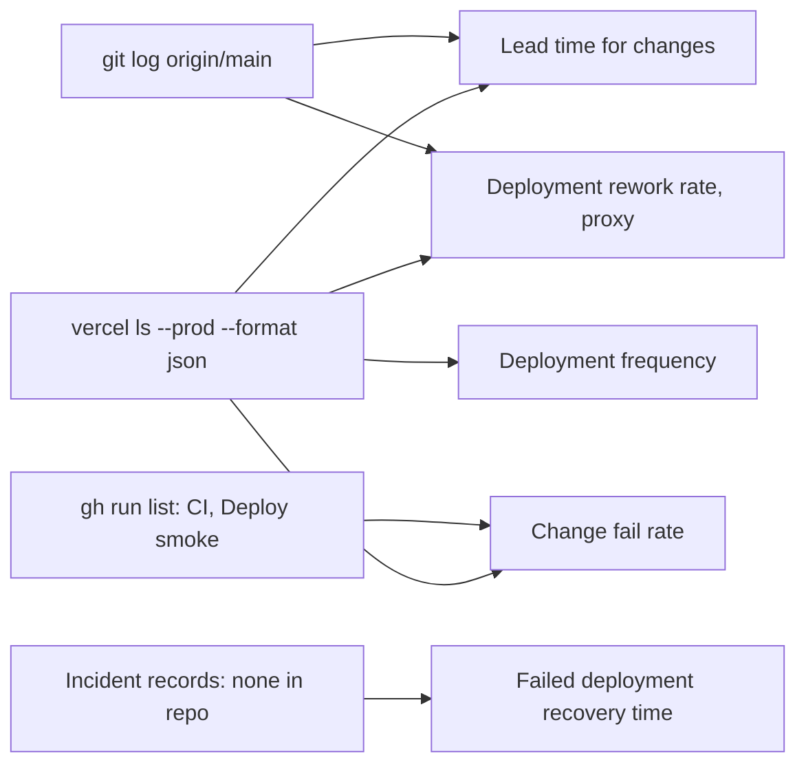

# 22 — DORA metrics

Status: **done** (window: 90 วัน 2026-08-05 → 2026-11-03; recovery time = cannot compute; rework = proxy)



Sources: commands below; `.github/workflows/deploy-smoke.yml`

## Production deployments in window

```bash
vercel ls bookchaowalit-devhub-frontend --prod --format json   # createdAt, meta.githubCommitSha
gh api 'repos/bookchaowalit-website/devtools-devhub-web/deployments?per_page=50' \
  --jq '.[]|[.created_at,.environment,.sha[:7],.creator.login]|@tsv'
```

| Deployed (UTC) | Head commit | GitHub Deployment record |
|---|---|---|
| 2026-08-23 15:47 | `38f060b` feat: redesign | no |
| 2026-10-08 01:48 | `860199d` fix(deps) next 15.5.27 | no |
| 2026-10-23 04:42 | `747847a` fix(security) next 15.5.28 | no |
| 2026-10-24 04:56 | `6a4357d` ci: deploy smoke | yes (`vercel[bot]`) |
| 2026-10-24 08:38 | `5da0dd6` fix(deps) | yes |
| 2026-10-24 09:58 | `ed11806` docs(kpi) | yes |

## Metrics

| Metric | How measured here | Value (90 d) |
|---|---|---|
| Deployment frequency | count of Vercel Production deployments | **6** (≈ 0.47 / week; 4 deploy-days) |
| Lead time for changes | per commit on main: commit time → first Production deploy containing it (`git merge-base --is-ancestor`) | **median ≈ 35.9 h** (2,152.5 min, n = 20); min 0 min, max 12.6 d (`c456a53` 08-11 → deploy 08-23) |
| Change fail rate | deploys followed by failed smoke, rollback or hotfix for a prod defect | **0 / 6 known** — smoke exists only for the last 3 (3/3 success); no rollback seen; `5da0dd6` fixed a CI security-scan failure, not a prod defect |
| Failed deployment recovery time | incident open → restored | **cannot compute** — no failed deployment or incident record in window |
| Deployment rework rate | share of deploys that are unplanned fixes to a previous deploy | **proxy 0 / 6** by that definition; if every `fix(...)` head counts: 3 / 6, but all three are dependency/security patches, not rework of a bad release |

Lead-time command:

```bash
printf '%s\n' "38f060b 2026-08-23T15:47:00Z" "860199d 2026-10-08T01:48:00Z" "747847a 2026-10-23T04:42:00Z" \
  "6a4357d 2026-10-24T04:56:00Z" "5da0dd6 2026-10-24T08:38:00Z" "ed11806 2026-10-24T09:58:00Z" > deploys.txt
for c in $(git log --since=2026-08-05 --format=%h --reverse origin/main); do
  ct=$(git show -s --format=%ct "$c")
  while read d dt; do
    if git merge-base --is-ancestor "$c" "$d"; then echo "$c $(( ($(date -d "$dt" +%s) - ct) / 60 ))"; break; fi
  done < deploys.txt
done | awk '{print $2}' | sort -n | awk '{a[NR]=$1} END{print "n="NR, "median_min="(NR%2?a[(NR+1)/2]:(a[NR/2]+a[NR/2+1])/2)}'
```

CI context: `gh run list -L 200` → CI 5 success / 2 failure / 1 cancelled; Deploy smoke 3 success. CI failure on `6a4357d` did not block its deploy (ADR-0003).

## Open questions

- ต้องการบันทึก incident (เช่น issue label) เพื่อวัด recovery time หรือไม่
- Playground ที่พังเพราะ sibling (2026-11-03) นับเป็น "change failure" ของ DevHub หรือไม่ — ไม่ได้เกิดจาก deploy ของ repo นี้
